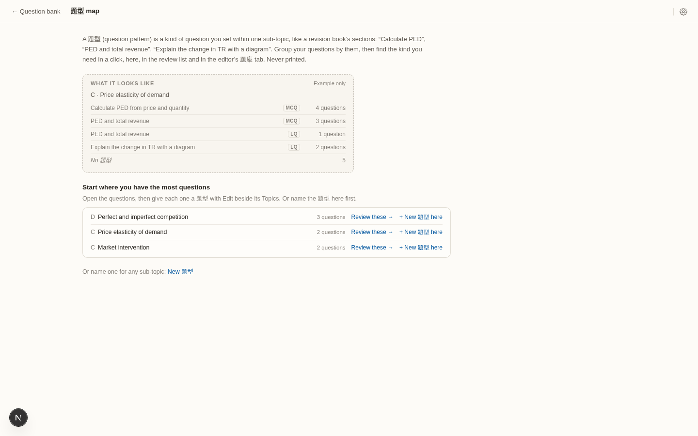
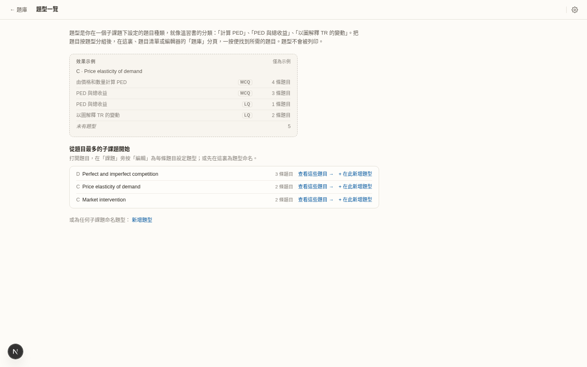
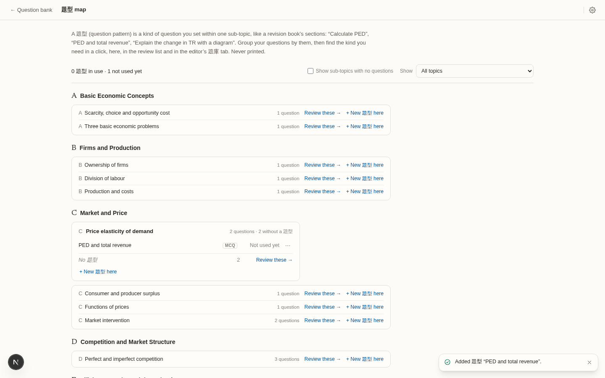

# 題型 map with no 題型: research and redesign proposal

Status: proposal, 2026-10-19, against `develop` at `051ee837` (after the first 題型 release,
`question-types-ux.md` § 8). **Items 1–4 and 6 built the same day on
`feature/question-types-empty-state`; see § 8.** The user asked: "improve the UI of the 題型 panel
even when the user has no pattern in; do a deep research on how we should design that
page." Screenshots are in `docs/design/question-types-ux/` with the prefix `v2-`.

Read first: `question-types-ux.md` § 4 (the redesign this builds on, including Sort mode,
Screen 3) and § 6 (the user's answers: keep 題型, no starter set, one list per sub-topic
with MCQ/LQ badges, a derived example).

## 1. What a first-time teacher sees today

Captured at 1440×900 from the dev build. The library was the website demo seed: 37
questions, zero 題型.





**From the 題型 map to a first question with a 題型 takes 5 clicks plus typing.** From
Home, it is 7.
1. Review these →
2. Edit (beside Topics)
3. + Add 題型, an 11px link in the 40-row Topics dialog (`v2-d2-edit-topics-en.png`)
4. Type the name and pick it
5. Save topics

Each later question costs about 4 more clicks. The toast then says "Topics saved." and
never mentions a 題型 (`v2-d5-after-save-en.png`).

Problems, most important first:

1. **The page falls off a cliff after the first name.** The first-run layout depends on
   `firstRun = items.length === 0` (`src/components/bank/page/PatternsPage.tsx:82`). As
   soon as one name exists, even an unused one:
   - the example and "Start where you have the most questions" disappear;
   - about 35 sub-topic rows appear, each with "Review these →" and "+ New 題型 here", which
     is about 70 identical blue links (`v2-e-one-pattern-unscoped-full-en.png`, 2088px tall);
   - the teacher's one success is shown in grey as "Not used yet".
2. **The page never shows a question.** The work happens on two other screens: review and
   then the Topics dialog. The page explains this in prose (`startHint`) instead of letting
   the teacher do it here.
3. **Naming and using are two separate paths.** "+ New 題型 here" creates a name and stops.
   "Review these" opens questions but offers no 題型. The teacher has to connect the two.
4. **The first five seconds are prose.** The visual lead is a three-line intro.
   - The example card is greyed and dashed, so it reads as *disabled*, not as a promise.
   - Every action has the same weight: a blue text link. There is no primary action.
5. **The suggestions are thin on a real library.** The demo's best sub-topic has 3
   questions. A typical library has 1–3 questions per sub-topic (see § 3), and sorting 2
   questions into "kinds" means nothing.
6. **Wording and details:**
   - "Review these" actually means "sort these".
   - "No 題型" sits beside a bare number.
   - "Or name one for any sub-topic" brings back the 40-option select.
   - In 中文, sub-topic names stay English (`topicName(…, view)`).
   - The raw code "C.ped" leaks into the review crumb (`QuestionBankScreen.tsx:842`).
   - Coming back from review re-scopes the map to one sub-topic without asking
     (`QuestionBankScreen.tsx:928`).
   - The 題型 button shows on an empty bank (`v2-a0-empty-bank-en.png`).

## 2. Outside research

Every claim is cited. *Inferred* marks our own reading.

- **Empty states.** NN/g says an empty state should show the system's status, teach what
  will appear there, and give a direct way into the task
  ([NN/g](https://www.nngroup.com/articles/empty-state-interface-design/)).
  - Tutorials and coach marks do not improve task performance
    ([NN/g](https://www.nngroup.com/articles/onboarding-tutorials/)).
  - Users skip setup and start doing the task (the "paradox of the active user"), so the
    advice is to promote learning by doing
    ([NN/g](https://www.nngroup.com/articles/paradox-of-the-active-user/)).
  - No published controlled test compares blank slates, templates and sample data. The
    activation percentages that circulate have no method behind them.
- **What you show, users copy.** In MovieLens tagging, users "create tags resembling other
  tags they see", and which tags were displayed changed the vocabulary
  ([Sen et al. 2006](https://www.cs.cornell.edu/~danco/research/papers/sen-cscw2006.pdf)).
  - So the example on the page is a strong lever. It should show *how names are shaped*,
    not a list to copy, which also keeps "no starter set".
- **The closest interaction model: Gradescope's answer groups**
  ([guide](https://guides.gradescope.com/hc/en-us/articles/24838908062093-AI-assisted-grading-and-answer-groups)).
  - A group has at least 2 items. The teacher names or deletes it, and Space pulls out an
    item that does not belong.
  - Confirmed groups are kept, and unconfirmed ones are discarded on reprocessing.
  - Apple Photos (merge similar people) and Gmail ("do this for all future messages?")
    follow the same pattern: *create a group from a selection, then offer to extend it*.
- **Fast bulk sorting** uses number keys mapped to buckets
  ([Zotero](https://www.zotero.org/support/collections_and_tags) 1–9 for coloured tags,
  [Lightroom](https://helpx.adobe.com/lightroom-classic/help/keywords.html) Alt+1–9).
  It also uses multi-select and one command
  ([Anki browser](https://docs.ankiweb.net/browsing.html)).
  - Card-sort studies keep a sort to 30–50 items. Past that, people make a
    "Miscellaneous" pile
    ([Optimal Workshop](https://www.optimalworkshop.com/101-guides/card-sorting-101/how-to-create-your-first-click-test),
    [NN/g](https://www.nngroup.com/articles/card-sorting-definition/)).
- **Avoid a catch-all bucket.** Moodle's automatic "Default for [course]" category becomes
  a dumping ground ([JAMK](https://help.jamk.fi/moodle/en/content-creation/question-bank/)).
  In Google Classroom, a post with no topic simply sits at the top
  ([help](https://support.google.com/edu/classroom/answer/9093681)).
  - *Inferred:* "No 題型" stays a derived count, never a 題型.
- **No teacher tool we found groups questions into teacher-named patterns within a topic.**
  - Exam-mate's "question type" is the paper format.
  - Isaac Physics ships ready-made decks.
  - Carousel starts teachers on a community bank.
- **How HK teachers and tutors name 題型.** We collected 22 real examples
  ([dsetreasure 2024 P1](https://dsetreasure.com/dse-econ-mc-solution/),
  [Outliers by-topic](https://sites.google.com/view/outlierseconomics/index/dse-econ/dseecon_video/dseecon_video_bytopicpastpaper),
  [dseapp AD-AS](https://www.dseapp.com/blog/dse-econ-ad-as-model/)). They come in three
  shapes:
  - **Command + concept:** 計算需求價格彈性, 以 AD-AS 解釋短期影響, 區分貨幣政策與財政政策.
  - **Concept pair:** 從量稅與彈性 / Per unit tax & Elasticity, 配額與總支出.
  - **Cause → effect:** 價格上限 → 超額需求. Tutors teach "每個箭頭都係一個得分點".

  No site publishes a full per-topic list.

## 3. Can the app suggest 題型 from the teacher's own questions?

We prototyped a deterministic grouper with no AI (scratch only, not committed). It grouped
LQ parts by command phrase and MCQs by stem shape: numeric options, diagram, table, (1)(2)(3)
statements, "Which of the following".

- **Demo library:** 39 items in 34 (sub-topic, type) buckets. 30 buckets hold one item. It
  made 3 suggestions, all stem shapes ("Which of the following…"), none a 題型.
- **The 2019 HKEAA Paper 2** (42 LQ leaves) gave "Explain ×17", "no command word ×11"
  (sub-parts whose command sits in the parent's lead), "Explain with a diagram ×4" and
  "Calculate ×3". These are skill bands (C12), not 題型.
- **Chinese commands are easy** (計算, 解釋, 以圖解釋, 試討論, 指出). English and Chinese
  agreed on the command for 20 of 22 bilingual parts.
- **The bank index holds no part text and no part marks**
  (`src/library/types.ts:BankRow`). A suggester would have to load documents or add
  derived per-part fields to the index (an index-format bump and a rescan; no document
  schema change).

**Verdict: no suggestion boxes.** On the libraries this page is meant for, they would come
up empty or with "Explain ×17". Use the same derived facts quietly instead, to *order*
the questions so that similar ones sit together (§ 4, "Order"). That pays off without
proposing names, and the facts become C12 later.

## 4. The redesign

### The idea

**Turn the map's empty state into a sort board.** The teacher's own questions are on the
page. They select two or three that are alike and name them, and that one act creates the
題型 and fills it. There are no separate "name" and "use" steps, no dialogs, and no shipped
list.

### Principles

1. **Questions, not names, are the starting point.** A 題型 is born full (Gradescope,
   Photos). Naming an empty 題型 stays possible, but it is secondary.
2. **One topic at a time.** The board works on one topic letter (C Market and Price), split
   by sub-topic. A topic usually has 5–40 questions, which is inside the 30–50 card-sort
   range and large enough to be worth sorting (one sub-topic is usually 1–3).
3. **Show how names are shaped, never a list.** The placeholder rotates through the three
   real shapes. Nothing is saved from it.
4. **No cliff.** The page has one layout. It changes in proportion to how much is sorted,
   not on `items.length === 0`.
5. **Untyped is fine.** "Not sorted · 5" is a count with an action. It is not a bucket or a
   warning colour.
6. **No storage change.** It writes ordinary `<sub-topic>::<name>` tags through the existing
   write path (`src/library/patterns.ts:patternWrites`, `src/library/tagWrites.ts`) and
   registry rows as today.

### Screen A: the map, no 題型 yet (library has questions)

```
← Question bank   題型 map                                                  [⚙]
──────────────────────────────────────────────────────────────────────────────────
  Sort your questions into 題型        37 questions · none sorted yet
  Group the questions you set into kinds, like a revision book's sections.
  Then pick "one of each" when you build a worksheet.  Never printed.

  Pick a topic to start                                   most questions first
  ┌──────────────────────────┐ ┌──────────────────────────┐ ┌─────────────────────┐
  │ C  Market and Price      │ │ D  Competition and Market│ │ F  Macro…           │
  │ 9 questions · 4 sub-topics│ │ 5 questions · 2 sub-topics│ │ 4 questions         │
  │ [ Sort C → ]  (primary)  │ │ [ Sort D → ]             │ │ [ Sort F → ]        │
  └──────────────────────────┘ └──────────────────────────┘ └─────────────────────┘
  All topics ▾  (A 2 · B 3 · E 4 · …, the rest in a compact list)

  ┌ What a sorted sub-topic looks like ──────────────────────────────────────┐
  │ C · Price elasticity of demand                                            │
  │   計算需求價格彈性                      MCQ  4                            │
  │   Per unit tax & elasticity             MCQ  3 · LQ 1                     │
  │   Price ceiling → shortage              LQ   2                            │
  │   Not sorted                                 5                            │
  └───────────────────────────────────────────────────────────────────────────┘
```

- **Status first, then one primary button.** The topic cards replace the three link rows.
  Only the first card's button is primary. "Most questions first" ranks topics by questions
  without a 題型 (a topic-level version of `startingSubTopics`).
- **The example sits under the action, not above it, and is not greyed.** It is a normal
  card labelled "looks like". Its names show the three shapes, in mixed languages, so they
  read as "how teachers name these" rather than a list to adopt. The text comes from the
  catalogue, as today.
- **"Name one for any sub-topic" moves into the board.** It is gone from this page.
- **The 中文 page uses 中文 sub-topic names** on chrome-only pages (it follows the UI
  language, not the paper language). This needs one decision from the user (§ 6).

### Screen B: the sort board (one topic)

```
← 題型 map   Sort C · Market and Price               9 questions · 0 sorted   [Done]
──────────────────────────────────────────────────────────────────────────────────
  Select questions that are alike, then name them.   ⇧-click selects a range

  Price elasticity of demand                                     5 not sorted
  ┌──────────────────────────────┐ ┌──────────────────────────────┐ ┌───────────
  │☐ MCQ · 1 mark                │ │☑ MCQ · 1 mark                │ │☑ MCQ · 1…
  │ The price of X rises from $8 │ │ When price rises 10%, Qd     │ │ Calculat…
  │ to $10 and Qd falls from …   │ │ falls 25%. PED is …          │ │ 
  │ ▸ preview                    │ │ ▸ preview                    │ │
  └──────────────────────────────┘ └──────────────────────────────┘ └───────────
  ┌──────────────────────────────┐ ┌──────────────────────────────┐
  │☐ LQ · (a) 2 · (b) 4          │ │☐ MCQ · 1 mark · diagram      │
  │ (a) Explain why…  (b) With   │ │ Refer to the figure. If the  │
  │ the aid of a diagram…        │ │ government…                  │
  └──────────────────────────────┘ └──────────────────────────────┘

  Market intervention                                            2 not sorted
  …
──────────────────────────────────────────────────────────────────────────────────
  2 selected   Name this 題型 [ e.g. 計算需求價格彈性            ]  [Create]  or [1–9 ▾]
```

- **The tray at the bottom** appears on the first selection. Typing a name and pressing
  Enter does two things at once:
  - it creates the 題型 under the cards' sub-topic and type;
  - it gives every selected card that tag.
- **The 題型 becomes a bucket row** above the sub-topic's cards: `[1] 計算需求價格彈性 · MCQ 2`.
  After that, the bucket's number key, or dropping the cards on it, sorts more questions
  into it. This is how Zotero and Lightroom use number keys.
- **Every write gets a toast with Undo**, worded about the 題型, not topics: "2 questions
  sorted into 計算需求價格彈性. Undo".
- **Extend after naming** (Gmail, Superhuman). After Create, if the same sub-topic has
  untyped questions with the same derived shape, the toast offers "3 more look similar:
  review". This shows them highlighted, each ticked individually, and nothing is applied
  without a click. When there is no match, the offer does not appear.
- **Order:** within a sub-topic, untyped cards are ordered by type, then by derived shape
  (MCQ stem shape, LQ command phrase, diagram). So similar questions sit next to each other
  without a box claiming they belong together. This is the only use of the § 3 heuristics.
- **Cards show enough to recognise a question:** type, marks, the first two lines of the
  excerpt, a diagram flag, and "▸ preview", which opens the existing `PaperPreview` in a
  popover. The excerpt shows the paper's language, as the review page does.
- **Questions with parts.** By default a card tags the whole question.
  - "Parts ▸" expands chips for (a), (b)… so each part can be selected on its own,
    matching TagAsYouGo's part strip.
  - Only parts within the selected sub-topic are offered.
- **Mixed selections:**
  - **Across sub-topics:** Create is disabled, with the reason "Pick questions from one
    sub-topic". That is the one real rule.
  - **MCQ + LQ:** allowed. It makes one name with two badges, exactly what "one list per
    sub-topic with badges" already shows, because the tag never held the type.
- **Keyboard:** J/K moves between cards, X selects, 1–9 sorts into a bucket, N focuses the
  name field, Z undoes, and Esc clears the selection.
  - This is for a teacher with 30 questions who is sorting a whole topic.
  - For a single-question flow, Sort mode (Screen 3 in `question-types-ux.md`) remains
    available from the rail's "Not sorted" link.
- **Done** returns to the map with the topic now shown as sorted.

### Screen C: the map in use, without the cliff

```
  Sort your questions into 題型        37 questions · 9 sorted · 3 題型
  ┌ Keep going ────────────────────────────────────────────────────────────┐
  │ C Market and Price  4 not sorted [Continue →]   D Competition  5 [Sort →]│
  └─────────────────────────────────────────────────────────────────────────┘

  C  Market and Price
  ┌ Price elasticity of demand ─────────────────── 5 questions · 1 not sorted ┐
  │ [1] 計算需求價格彈性                    MCQ  2 →   ⋯                       │
  │ [2] Per unit tax & elasticity           MCQ 1 · LQ 1 →   ⋯                 │
  │ Not sorted  1                                       [Sort →]               │
  └─────────────────────────────────────────────────────────────────────────────┘
  Market intervention · 2 questions, not sorted yet          [Sort →]

  Other topics: A 2 · B 3 · D 5 · E 4 · F 4 …  (one line, each a link)
```

- **Only topics that have 題型 get boxes.** Every other topic is a single "Other topics"
  line, not 35 rows. Sub-topics without questions are hidden, as today.
- **The summary line counts questions sorted**, the teacher's progress, not names "in use".
- **A name with no questions** still shows, with "No questions yet · Sort into it →". That
  link opens the board with this 題型 as bucket 1. It is no longer grey "Not used yet".

### Screen D: empty library

- Hide the 題型 button on the bank header until the library has at least one question with
  a sub-topic. The page is reachable only through a link.
- If the page is reached anyway (an old link, or after deleting everything), show one
  card:
  - "Your 題型 map fills as you write questions."
  - The example card.
  - Start a classroom worksheet.

### Wording (catalogue drafts)

Follows `docs/design/ui-language.md`. "Sort" is new; the review page's "Review these"
becomes "Sort these" where it means sorting.

| Key | English | 中文 |
|---|---|---|
| Heading | Sort your questions into 題型 | 把題目分成不同題型 |
| Status | {n} questions · none sorted yet | {n} 條題目 · 尚未分類 |
| Status, in use | {n} questions · {k} sorted · {p} 題型 | {n} 條題目 · 已分類 {k} 條 · {p} 個題型 |
| Intro | Group the questions you set into kinds, like a revision book's sections. Then pick "one of each" when you build a worksheet. Never printed. | 像溫習書的分類一樣，把你出的題目分成不同題型。製作工作紙時可每種揀一題。題型不會被列印。 |
| Pick a topic | Pick a topic to start | 選一個課題開始 |
| Sort button | Sort {letter} → | 分類 {letter} → |
| Board hint | Select questions that are alike, then name them. | 選取相似的題目，然後為它們命名。 |
| Name field | Name this 題型 | 為這個題型命名 |
| Disabled reason | Pick questions from one sub-topic. | 請只選取同一子課題的題目。 |
| Sorted toast | {n} questions sorted into {name}. | 已把 {n} 條題目分類到「{name}」。 |
| Extend | {n} more look similar: review | 另有 {n} 條相似：查看 |
| Not sorted | Not sorted | 未分類 |
| Example label | What a sorted sub-topic looks like | 分類後的樣子 |

The example names (計算需求價格彈性, Per unit tax & elasticity, Price ceiling → shortage)
are catalogue text and printed nowhere.

## 5. What to build, ranked

| # | Change | Value | Effort | Storage |
|---|---|---|---|---|
| 1 | Remove the cliff: one layout, "Other topics" line, progress summary, no grey "Not used yet" (Screen C) | High | S | None |
| 2 | Sort board for one topic: select → name → create + tag, buckets with number keys, Undo toast (Screen B) | High | M | None (tags + registry rows) |
| 3 | Empty map: status, topic cards with one primary button, re-shaped example (Screen A) | High | S | None |
| 4 | Small fixes: hide 題型 button on an empty bank; "Review these" → "Sort these"; no `C.ped` in the crumb; no silent re-scope; toast names the 題型 | Med | S | None |
| 5 | Order cards by derived shape; the "n more look similar" offer | Med | S–M | None (derived; part text may need loading the owning documents) |
| 6 | Sub-topic names follow the UI language on chrome-only pages | Med | S | None |
| 7 | Parts ▸ on cards | Med | S | None |

Build order: 1, 3 and 4 together (a small release that fixes what is broken today), then
2 and 7, then 5. Sort mode (one question at a time, `question-types-ux.md` item 4) becomes
a mode *inside* the board, used for long topics, rather than its own screen.

### Backward compatibility

- No document schema change. Nothing touches `src/model/types.ts` or `KNOWN_KEYS`.
- Creating a 題型 from the board writes the same `<sub-topic>::<name>` tags and the same
  registry rows (`src/storage/patterns.ts`) as the picker does today. Older builds read
  them unchanged.
- The extend offer (5), if it needs part text, either loads the owning documents (as
  TagAsYouGo already does, `useOwningDocument`) or adds derived fields to the bank index.
  The index is derived and rebuilt, so adding fields needs an index-format bump and a
  rescan, never a document migration.

## 6. Open questions for the user

**Answered 2026-10-19: all four as recommended** (by topic; 中文 sub-topic names on this
page; mixed-language example names; the extend offer later, after 1–3).

1. **Sort by topic (C) or by sub-topic (C · PED)?** **Recommended: by topic.** A
   sub-topic usually has 1–3 questions, too few to group, and the board still keeps each
   sub-topic's cards in its own section.
2. **Should 中文 UI show 中文 sub-topic names on the 題型 map** even when the paper view
   is English? **Recommended: yes on this page.** It holds only chrome, no paper content.
3. **The example names in mixed languages** (one 中文, two English, in both UIs)? They show
   the three name shapes and how teachers actually write. **Recommended: yes**, so it reads
   as an illustration, not a list to adopt.
4. **The "n more look similar" offer** (item 5). It proposes members but never names.
   Within "no starter set"? **Recommended: yes, later**, after 1–3 ship.

## 7. How this was checked

- **Audit:** the dev server driven by Playwright with system Chrome and the website demo
  seed (`scripts/demo/site-seed.test.ts`). Screenshots are `question-types-ux/v2-*.png`.
- **Prototype grouper:**
  - Content: the demo library, `src/test/corpus/`, `real_life_reference/2021.worksheet.json`,
    and four real `.docx` files plus 20 import fixtures, read through the app's import
    path.
  - It was scratch code and was not committed.
- **Web research:** 2026-10-19. The sources are linked inline. Activation numbers from
  vendor blogs were rejected for lack of method.
- **Not checked:** desktop shell, narrow windows, a library with more than 100 questions.

## 8. What shipped (2026-10-19)

No storage change: no document field, no registry field, no index field. The bank's
remembered level gains `{ kind: 'sort', topic }`; an older build reads it as the topics
(`parseLevel` falls back).

- **Item 1, no cliff.** The map has one layout (`PatternsPage.tsx`). The heading says where
  the library stands (`src/library/patterns.ts:sortProgress`: questions with a sub-topic,
  those with a 題型 in every one, 題型 named). With some 題型: "Keep going" (the three
  topics with most to sort, `:topicsToSort`), a box per sub-topic with 題型, that topic's
  other sub-topics on one line with "Sort C →", every other topic on one "Other topics"
  line. A name with no questions says "Sort into it →", not grey "Not used yet".
- **Item 2, the sort board** (`PatternSortBoard.tsx`, bank level `sort`). One coarse
  topic, a section per sub-topic with questions (`:sortSections`), unsorted questions as
  cards (type, marks, Diagram, the stem in the view language). Click selects, Shift-click a
  run; a selection stays in one sub-topic (a click in another starts a new one). The tray
  names it (Enter): the 題型 is registered under each selected type and every copy takes
  it where it holds the sub-topic (`:sortIntoEdit`, whole-question). A typed name that
  exists becomes "Add to “…”". 題型 are numbered buckets (`:sortBuckets`, MCQ and LQ of a
  name are one); 1–9 sorts into one, N names, Z or ⌘Z undoes (`:unsortEdit`, and the
  names that sort created leave the registry), Esc clears the selection, then goes up to
  the map. A done topic offers "Next: B →".
- **Item 3, the empty map.** Topic cards, the first one primary; the example card is not
  greyed and shows three name shapes, in mixed languages (計算需求價格彈性, Per unit tax &
  elasticity, Elastic demand → a price rise cuts TR). The 40-option "New 題型" form is gone.
- **Item 4, fixes.** The 題型 header button needs a question in the library and always
  opens the whole map; the review crumb shows the topic letter, not `C.ped`; "Review these"
  is gone from the map (its sorting is the board's).
- **Item 6.** Topic names on the map and the board follow the interface language
  (`src/components/bank/page/topicText.ts:chromeTopicName`).
- **Checked:** Chrome on the website demo seed, 1440×900, en and 中文, light and dark
  (`question-types-ux/v3-*.png`). **Not checked:** Tauri, Safari, narrow windows, a
  library over 100 questions, a question with parts on the board (it is sorted whole).
- **Not built:** item 5 (order by shape, "n more look similar"), item 7 (Parts ▸).
